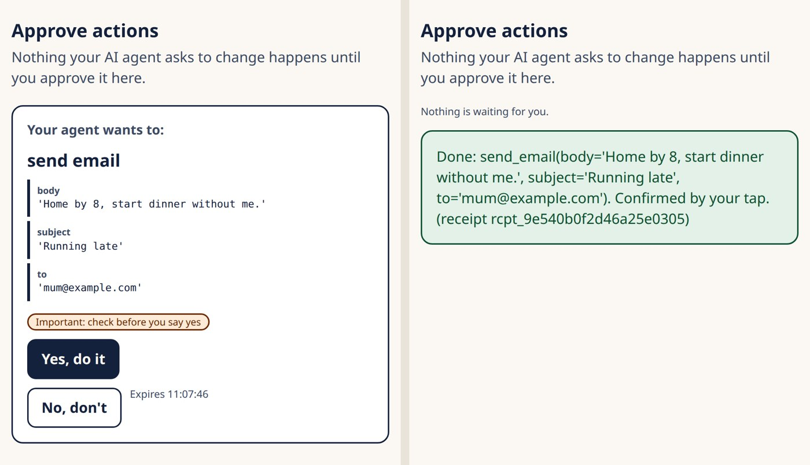

# confirm-gate-mcp

[](https://github.com/Prashant-thakur77/confirm-gate-mcp/actions/workflows/tests.yml)
[](https://github.com/Prashant-thakur77/confirm-gate-mcp/releases)
[](LICENSE)


**Confirm-before-act for MCP.** Put it in front of any MCP server. Read tools pass straight through. Every write tool becomes a pending card, and only the user's own tap or voice, on a device they paired, can release it.

The guarantee doesn't depend on a prompt. The agent never holds the one-time nonce or the device key that a confirmation needs, so it can't approve its own action, however it's instructed. A prompt injection can make the agent *ask*, but it can't make anything *happen*.



```
agent ──MCP (bearer token)──▶  confirm-gate  ──▶ upstream MCP server
                                  │  ▲
           nonce + cards ─────────┘  └──── signed evidence (tap / voice)
                              user's paired device  (/approve page or your own app)
```

## Why

An agent that can write (send, buy, delete, unlock) needs a human yes for the actions that matter. The usual ways of getting one all run through a channel the agent, or whatever is steering it, can reach:

- **A "do you approve?" in the chat.** The model can say "the user said yes", and an injected instruction can make it.
- **Tool annotations.** `readOnlyHint` and `destructiveHint` are hints from the server. The MCP spec says clients must treat annotations as untrusted unless they come from a trusted server.
- **A confirmation dialog in the agent's own client.** It lives in the same app as the agent, often with an "always allow" switch, and it gives nothing to audit afterwards.

confirm-gate moves the yes onto a second channel. The proposal goes to the agent; the one-time nonce goes only to the user's paired device, and every request from that device is HMAC-signed with a key the agent never sees. The write runs only when the evidence from that device checks out, and every run leaves a receipt.

It began as the safety layer of [SureSay](https://github.com/Prashant-thakur77/SureSay), a voice assistant for people with dysarthria. Their speech is misheard more than anyone's, so an assistant that acts on its best guess does the wrong thing to the people with the least room to undo it.

## Proof

Measured in SureSay's evaluation ([report](https://github.com/Prashant-thakur77/SureSay/blob/main/eval/REPORT.md#claim-3--nothing-changes-without-the-user)): 50 adversarial cases over HTTP, made up of 20 prompt injections hidden in tool output, 15 near-miss commands and 15 forged confirmations (self-confirming, replayed evidence, expired sets, cross-user evidence, captured signed requests, pairing brute force, racing confirms).

| Agent | Unconfirmed changes |
|---|---|
| Scripted worst-case agent (obeys every injection, tries every forgery), no gate | 35 / 35 |
| Same agent, behind the gate | **0 / 50** |
| A real model, Amazon Nova 2 Sonic, as the agent, no gate | 11 / 35 |
| Same model behind the gate, with `confirm` among its tools | **0 / 35** |

## 60 seconds

```bash
pip install "git+https://github.com/Prashant-thakur77/confirm-gate-mcp"
confirm-gate serve --upstream-cmd "uvx mcp-server-time"       # or --upstream http://host:port/mcp
```

It prints three things:

- the agent's endpoint, `http://127.0.0.1:8800/mcp`, with a bearer token;
- the approval page, `http://127.0.0.1:8800/approve`;
- a 6-digit pairing code.

Open the page, enter the code, and point your agent at the endpoint. When the agent calls a write tool, it gets back:

```json
{"status": "pending_user_confirmation", "pending_id": "p_3f…", "preview": ["write_note(name='a', text='hi')"],
 "message": "Waiting for the user to confirm on their device. Nothing has changed yet."}
```

The card appears on your page, and nothing happens until you approve it there.

## A server you don't control: `--strict`

By default a tool the upstream marks `readOnlyHint` passes through. For a server you didn't write, don't take its word for it:

```bash
confirm-gate serve --upstream-cmd "npx -y @modelcontextprotocol/server-filesystem ~/sandbox" \
    --strict --reads "read_*,list_*,search_*,get_*,directory_tree" --high-risk "move_*"
```

| option | meaning |
|---|---|
| `--upstream URL` / `--upstream-cmd CMD` | the server to gate: Streamable HTTP, or a stdio command |
| `--strict` | ignore the upstream's `readOnlyHint`; only tools in `--reads` pass through ungated |
| `--reads` | tools or glob patterns that pass through |
| `--writes` | tools or patterns that are always gated, even if marked read-only |
| `--high-risk` | tools or patterns that need a second, separate yes when picked from a set of cards |
| `--token`, `--db`, `--host`, `--port`, `--user` | bearer token (default: generated), SQLite file or `:memory:`, bind address, user id |

The same options are arguments of `wrap_upstream(...)` and `build_app(...)` in Python (`trust_annotations=False` is `--strict`).

## With an agent

Any Streamable HTTP MCP client works: give it the endpoint and the bearer token. With [Strands Agents](https://strandsagents.com) on Amazon Bedrock ([`examples/strands_agent.py`](examples/strands_agent.py)):

```python
from strands import Agent
from strands.models import BedrockModel
from strands.tools.mcp import MCPClient

gate = MCPClient(url="http://127.0.0.1:8800/mcp", headers={"Authorization": f"Bearer {token}"})
with gate:
    agent = Agent(model=BedrockModel(model_id="us.amazon.nova-2-lite-v1:0"), tools=gate.list_tools_sync())
    agent("Move every .tmp file in ~/sandbox into old/")  # the moves wait on your phone
```

The gated tools tell the agent what is going on: each write's description says it waits for the user's own confirmation, its reply is `pending_user_confirmation`, and `pending_status` tells it when the user has decided.

**Agent Skill.** [`skills/add-confirm-gate/SKILL.md`](skills/add-confirm-gate/SKILL.md) teaches a coding agent (Claude Code, Kiro, Cursor) to put the gate in front of a server: which way in, `--strict` for servers you didn't write, how to choose reads and high-risk tools, and how to check the result.

## In your own server (20 lines)

[`examples/wrap_any_server.py`](examples/wrap_any_server.py) wraps an in-process server. The same `build_app(upstream, …)` call accepts any of these:

- an `MCPServer` object;
- a Streamable HTTP URL;
- `StdioServerParameters`.

To build the gate into a server you're writing, register tools through `GatedServer`:

```python
from mcp.server import MCPServer
from confirm_gate import GatedServer, SqliteStore

mcp = MCPServer("home")
gs = GatedServer(mcp, store=SqliteStore("gate.db"))

@gs.read()
def door_status() -> dict:
    """Is the front door locked?"""
    return {"locked": True}

@gs.write(risk=lambda a: "low" if a["locked"] else "high",
          preview=lambda a: "Lock the front door" if a["locked"] else "Unlock the front door")
def door_lock(locked: bool) -> dict:
    """Lock or unlock the front door."""
    ...  # runs only after the user confirms
```

Then mount `confirm_gate.device_routes(gs.gate, gs.devices, transcribe=...)` next to `/mcp` for your device app.

## What `confirm` checks

Anyone may call `confirm(pending_id, evidence_ref)`, the agent included. It executes only if every check passes, and each check is listed by name in the receipt:

| check | refuses |
|---|---|
| `user_evidence_exists` | no evidence, a made-up id, "the user said yes" |
| `evidence_is_for_this_card_set` | evidence from another card set |
| `from_a_paired_device` | an unknown or revoked device, or another user's device |
| `card_set_still_open` | a second confirm of the same set (replay) |
| `card_set_not_expired`, `evidence_not_expired` | stale cards (120 s; 60 s for the second yes) |
| `evidence_not_used` | evidence used before |
| `user_words_choose_a_card` | "no", "not two", "um", or a number on a yes/no card |
| `action_unchanged_since_shown` | arguments that changed after the user chose |
| `nonce_consumed_once` | racing confirms: exactly one wins (atomic in every store) |

The device channel adds its own protections:

- Every request is HMAC-signed with the device key.
- Each signature is accepted once, inside a ±60 s window.
- Pairing codes are one-time and valid for 10 minutes. Each attempt takes from two atomic budgets before the code is checked: 5 wrong tries per 10 minutes per source address, and 30 for everyone together. Parallel guesses and freshly started pairings can't reset or outrun them, and one guesser can't lock out the owner.
- Only a device paired as a voice device (`start_pairing(user, transcriber="alexa")`) may send its own transcripts, and the receipt names that recogniser.
- A voice recording's fingerprint can't be used twice.
- High-risk actions need a second, separately nonced yes.
- **More time** (WCAG 2.2.1): `gate.extend(pending_id, user_id=...)` restarts a waiting set's own clock, at most 10 times per set. It answers nothing, it is never an MCP tool, and only a route you sign for the user's own device should call it. `device_routes` mounts one, `POST /device/more-time {"pending_id"}`, and the built-in `/approve` page puts a **More time** button beside each set's countdown, with a polite warning at 30 s.

## Voice

Voice evidence is audio. The server transcribes it with your recogniser, so the words come from the user's own recording, never from the model's account of what they said. `confirm_gate.consent.decide` turns the words into a decision:

- **Picks a card:** "two", "the second one", "number 2", "option three". In Hinglish: "doosra", "do number", "teen number", "दो नंबर".
- **Confirms the final card:** "yes", "haan", "theek hai".
- **Cancels:** "no", "cancel", "nahin", "mat karo".
- **Refused:** everything else, including a bare "do", "not two", "yes no", or a sound-alike such as "to"; hesitations and hedges ("hang on", "ek second", "maybe", "shayad", "sochne do"); and, on the high-risk final card, any word it can't read other than the card's own words.

## Stores

- `MemoryStore`: tests and single process.
- `SqliteStore`: one file, safe across threads and processes.
- `DynamoStore`: one on-demand table, conditional writes for one-time use.

All three give the same `put_if_absent` / `set_once` / `add` (atomic counter) / `update` (compare-and-swap) guarantees, and the same tests run against each.

## Receipts

Every executed write leaves a receipt with:

- who confirmed (user and device);
- what ran (action, arguments, and the card text shown);
- when it was proposed, confirmed and executed;
- how it was confirmed: tap or voice, the server's transcript, and the audio fingerprint;
- every check, by name.

`receipt.verify_fingerprint(r)` detects a receipt edited after it was issued.

## What it does not protect against

- **Reads.** They pass through. Anything a read tool returns, the agent sees.
- **A compromised paired device.** Whoever holds the device key can approve. Unpair a lost device (`DeviceRegistry.revoke`).
- **A compromised upstream server.** The gate decides *whether* a call runs, not what the server then does with it.
- **Approving without reading.** The card shows the exact action and arguments, and they can't change after the user chooses; it can't make anyone read them.
- **Plain HTTP.** `confirm-gate serve` binds to localhost. Put anything reachable from elsewhere behind HTTPS.

## Develop

```bash
pip install -e ".[dev]"
pytest -q     # about 420 tests; the DynamoDB ones run on moto
```

Issues and pull requests are welcome. A change near the gate starts with a failing test in `tests/`. Report a security problem privately through [GitHub security advisories](https://github.com/Prashant-thakur77/confirm-gate-mcp/security/advisories/new), not in a public issue.

## License

MIT
